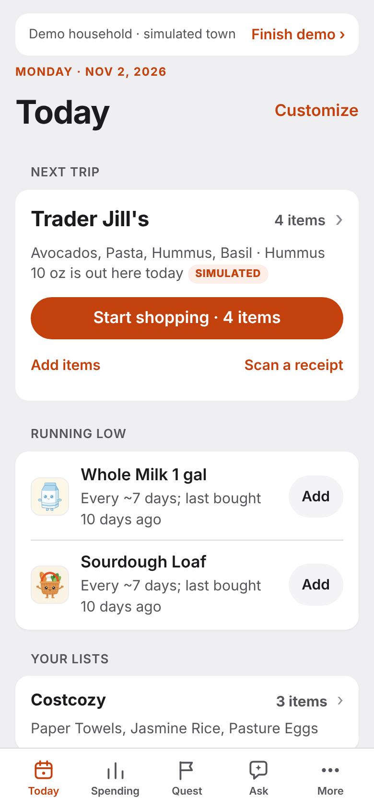
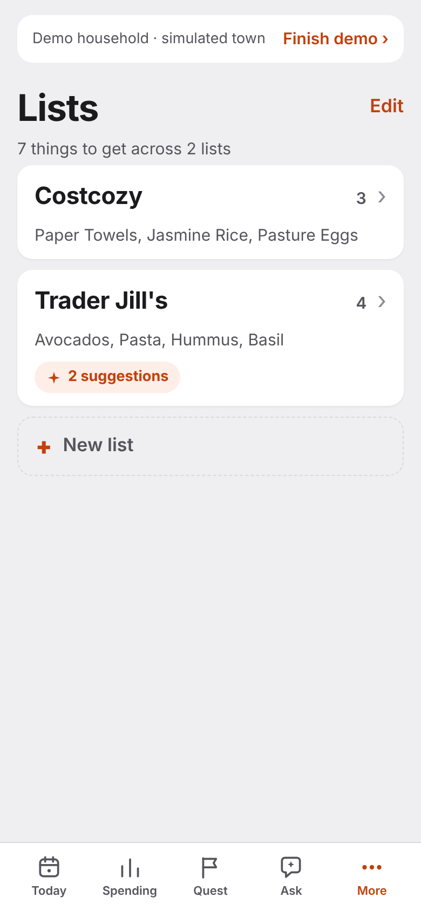
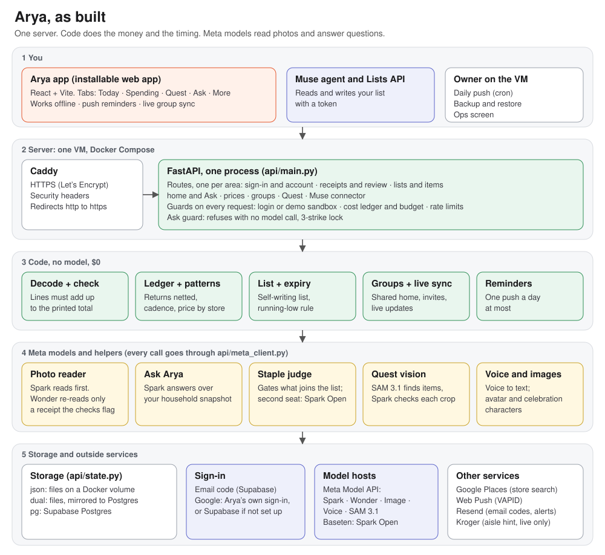

<p align="center">
  
</p>
<!-- Badge numbers: the Doc maintainer updates "python tests" from the STATUS.md Python test count and "receipt arithmetic" from the "My corpus" line under Measured results whenever either changes; "people in scans" follows the Map my store row. -->
<p align="center">
  
  
  
</p>

<p align="center">
  <a href="https://vibhortayal.github.io/arya/"><strong>Read the docs site</strong></a>
  (a good place to start) &nbsp;|&nbsp;
  <a href="https://arya.teamnightshift.org"><strong>Open the live demo</strong></a>
  (tap "Try it now", no sign-up) &nbsp;|&nbsp;
  <a href="JUDGES.md"><strong>Judging this? Start here</strong></a>
  &nbsp;|&nbsp;
  <a href="#documentation-map"><strong>All the docs</strong></a>
</p>

<p align="center"><strong>Contents:</strong>
  <a href="#what-is-arya">What is Arya</a> ·
  <a href="#live-demo">Live demo</a> ·
  <a href="#try-it-in-one-minute">Try it in one minute</a> ·
  <a href="#verify-it-without-signing-in">Verify it</a> ·
  <a href="#how-it-fits-together">How it fits together</a> ·
  <a href="#run-it-yourself">Run it yourself</a> ·
  <a href="#measured-results">Measured results</a> ·
  <a href="#what-are-the-known-limits">Known limits</a>
</p>

## What is Arya

**Groceries are a big part of life, one of the largest expenses in the budget,** and think about what it takes today.

You have a “Trader Jill” list in your notes, your partner sends you items over text, and they have a list for the “Costcozy” store — and both lists don't talk to each other. So **both of you bought yogurt, and neither bought the toilet paper that ran out.**

At the store, **the milk your kids need is out of stock,** and you walk every aisle to find the rest. The receipt goes in the trash, so **you never see where the money went,** or that the same item was cheaper at another store. Then **the spinach goes bad** before anyone uses it.

> *You hold all of it in your head, and it's still never quite right.*

**Arya puts the whole chore in one place** — **shared lists**, **a guided route** so you get out of the store quicker, **visibility into your spend and usage patterns**, and **out-of-stock warnings from other shoppers** so your trip isn't wasted. I built Arya for this hackathon to make the whole grocery routine easier, so I don't have to manage it mentally.

---

**Arya learns from my receipts,** and it remembers what I share with it so I don't start from zero every week. The list is already made from what we buy.

**I add** by typing, by voice — **Muse Voice Transcribe** — or a photo of a paper list — **Muse Spark** converts it into a list.

**At the store,** if I can't find something, I tap **Can't find it**, then **Find it for me**, and point the camera at the shelf: **SAM 3.1** marks the possible spots, **Spark** checks them, and the match lights up. *This shelf is empty,* so I tap **The shelf is empty**. Once three shoppers have reported the same item at a store, other shoppers who have it on their list and shop there see an alert.

**At checkout** I snap the receipt. **Spark** reads it, Arya checks the math, and if anything is off, **Muse Wonder** takes a second look. *Next week's list is already learning.*

---

**Back home,** the spinach is about to go bad, so Arya tells me to use it first. I finish the yogurt, I tell Arya we're out, and *it's on the list.*

---

**Arya is live** — the demo is open to everyone, no sign-up; accounts are by invite from the waitlist for now for beta testers. *Honestly, it's early:* a week is not enough to build all of this, and it gets better as more of us use it.

**Arya is a hackathon product. With Meta's help, it could come to life and reach more people: a platform for a problem most of us face and never solve, because other things in life take priority. Arya frees up that time and mental space.**

**The potential is bigger.** The eyes that read a shelf today could run on **Meta glasses** tomorrow. Stores could partner too — only where it makes the community better. A [developer portal](https://arya.teamnightshift.org/developers) is live for API integration. AI agents like **Meta Muse** can already integrate over **MCP** and talk to Arya.

> **The AI does the remembering. We do the shopping, and we help each other.**
>
> **This is Arya.**

*Built for the Meta Global AI Developer Hackathon 2026 (Team Nightshift, Indie track).*

<p align="center">
  
  
</p>

*Today and Lists in the demo household.*

### What is real, and what is not?

| Real | Simulated |
|---|---|
| The live app. Receipts read by Meta models and checked in code. The Lists API and the Muse connector. | The demo household and Demo Town: invented stores and receipts, labelled as simulated. The demo reads a receipt live but keeps nothing. |

Size and other limits: [Known limits](README.md#what-are-the-known-limits).

## Why I built it this way

**A PWA (progressive web app).** A PWA is a website you can add to your phone's Home Screen, so it opens like an app with nothing to install from an app store. One link works on any phone, with no app-store review. It opens from there, keeps your lists usable with no signal and can send reminders, and a judge can open it in one tap. A PWA was the fastest way to build and ship in a hackathon. After the hackathon I plan to build native iOS and Android apps.

**The stack.** React, TypeScript and Vite for a phone-first app I could change quickly, with three.js for the Quest store world. One Python (FastAPI) process serves the API and the app, so there is one thing to run and debug. Each account's data is JSON documents, mirrored to Supabase Postgres on the live site. JSON is easy to back up, read and export, so your receipts go with you if you leave. After judging, Postgres can become the master copy.

**The hosting.** I run Arya on a free Oracle Cloud VM with Docker Compose and Caddy. I chose Oracle because it is Always Free and I already knew it. The VM already existed for other hobby projects; setting up Arya on it began on Oct 27. Caddy gives HTTPS and security headers with almost no setup, and "Run it yourself" uses the same Compose files.

**The coding model.** Muse Code wrote the first version of the engine and I built the rest of the app with Claude. Details under [Build tools](#how-this-was-built).

**The Meta models.** Each model has one job, and the cheapest one that holds its score does it. Spark reads receipts first because it is fast and cheap. Wonder re-reads only receipts the arithmetic flags, because it is more accurate but about nine times the cost and four times slower. SAM 3.1 finds items on a shelf and pixelates people. Voice Transcribe turns speech into text for the list mic. Muse Image painted the celebration characters once. Spark Open gives a second opinion on the staple judge. Numbers are in [`MODEL-POLICY.md`](assistant/docs/MODEL-POLICY.md).

**Muse can use Arya.** Arya has a standard MCP connector, and Muse is the reference client: ask the Muse agent to connect to Arya, paste the code into the secure credentials vault Muse opens (never the chat), and Muse can read your list, add items, check them off and file a receipt it read in chat, through six tools. I tested it on my own Muse on 2026-11-02. Setup: [the agent connector](assistant/docs/AGENT-CONNECTOR.md).

**Rome wasn't built in a day.** A community can't be built inside one hackathon. What I finished is the foundation: the more shoppers use Arya, the better its store maps get, and later, if shoppers choose to share prices (not switched on yet), its prices too. The more people use it, the more it gives back to them.

## Live demo

**Live demo:** https://arya.teamnightshift.org. The demo opens a fictional
household with no account. Your changes live in a sandbox for your visit only;
nothing reaches disk or another visitor. It is best on a phone; on a laptop,
make the window about 390 px wide. Open Lists API and docs for developers:
https://arya.teamnightshift.org/developers.

Submission deadline: Nov 4, 2026, 9:00 PM ET.

## Documentation map

| If you want to know... | Read |
|---|---|
| What was made and when, then every feature with why it matters | [`docs/WHAT-WE-BUILT.md`](docs/WHAT-WE-BUILT.md) |
| The rubric, model map and proof | [`JUDGES.md`](JUDGES.md) |
| What the product is, in full | [`assistant/docs/SPEC.md`](assistant/docs/SPEC.md) |
| Screen-by-screen journeys | [`assistant/docs/USER-JOURNEYS.md`](assistant/docs/USER-JOURNEYS.md) |
| How it fits together | [`assistant/docs/ARCHITECTURE.md`](assistant/docs/ARCHITECTURE.md) |
| Which model does what, and what it costs | [`assistant/docs/MODEL-POLICY.md`](assistant/docs/MODEL-POLICY.md) |
| Every Meta model available, used, and future ideas | [`docs/MODELS.md`](docs/MODELS.md) |
| Stack, hosting, deploy, backups | [Tech stack and deployment](#tech-stack-and-deployment), [`assistant/docs/OPS.md`](assistant/docs/OPS.md) |
| The Quest game | [`docs/quest/README.md`](docs/quest/README.md), [`docs/quest/GAME-DESIGN.md`](docs/quest/GAME-DESIGN.md) |
| Using your own AI assistant | [`assistant/docs/AGENT-CONNECTOR.md`](assistant/docs/AGENT-CONNECTOR.md) |
| Measured results | [`docs/evals/`](docs/evals/) |
| Open API | https://arya.teamnightshift.org/developers, [`docs/API.md`](docs/API.md) |
| Running it on your own computer | [`docs/RUN-IT-YOURSELF.md`](docs/RUN-IT-YOURSELF.md), and a feature-by-feature tour: [`docs/TRY-THE-FEATURES.md`](docs/TRY-THE-FEATURES.md) |
| Why it exists and what it stands for | [`docs/PRINCIPLES.md`](docs/PRINCIPLES.md) |
| What is not built yet | [`docs/ROADMAP.md`](docs/ROADMAP.md) |

**Code layout.**

| Path | What |
|---|---|
| `assistant/api/` | FastAPI app, one router per area in `routes/`, engines |
| `assistant/web/` | React app (screens, Quest game, service worker) |
| `assistant/pwa/` | Static files: images, three.js, manifest, icons |
| `assistant/deploy/` | Docker Compose, Caddyfile, backup and restore scripts |
| `assistant/docs/` | Spec, architecture, model policy, runbooks |
| `docs/quest/` | Quest design and the hackathon doc pack |
| `assistant/loops/` | One log per work session |
| `STATUS.md` | What is true on `main` today |

Agents: read [`AGENTS.md`](AGENTS.md) first. The spec
(`assistant/docs/SPEC.md`) wins when it disagrees with the code.

## Try it in one minute

1. Open the demo. **Today** shows what is running low and why.
2. Tap **More**, then **Lists**, and open a list. Add an item by typing, with the mic, or with a photo of a handwritten note.
3. Open **Ask** and type "We finished the Greek yogurt", then "What am I running low on?".
4. Open a list and tap **Start shopping** to start a quest at that list's store.
5. For a longer path through the app, see [`docs/quest/JUDGE-PLAYBOOK.md`](docs/quest/JUDGE-PLAYBOOK.md).

The navigation tab (the row of buttons at the bottom) starts as Today, Spending, Quest, Ask and More. More holds Lists, Receipts, Stores, Help, Settings and every place not on the navigation tab. Each shopper can change it: touch and hold it, or tap More, then Customize navigation tab.

## Verify it without signing in

Everything below runs in the demo household, no account needed. "Live" means the demo calls the Meta Model API when you tap; the allowance is in [Known limits](#what-are-the-known-limits).

| Feature | Tap | You see | Meta model | Code |
|---|---|---|---|---|
| Receipt read and arithmetic check | More, Receipts, Add receipt, Snap (or "Use a sample receipt") | Lines, "Total checks out", which model read it | Muse Spark 1.3 reads first; Muse Wonder 1.0 re-reads a flagged read (live); the sample is code-built, no model | `assistant/api/decode/service.py`, `decode/checks.py` |
| Add by voice | A list, the mic | Items added, with Undo | Muse Voice Transcribe (live) | `assistant/api/voice/service.py` |
| Add from a photo of a note | A list, the camera | The items Arya read, "Add N items?" | Muse Spark vision (live) | `assistant/api/list/intake.py` |
| Running low and the staple judge | Today, Running low; a suggestion's "why" | Cadence, last buy, the judge's verdict | Judged before the demo was built: Muse Spark judge, Muse Spark Open second seat (no live call) | `assistant/api/judge.py`, `assistant/api/patterns/` |
| Ask Arya | Ask Arya, type a question or tap a chip | An answer from the household data; a stated fact becomes an action you confirm | Muse Spark (live) | `assistant/api/chat_service.py` |
| Use soon date read | Today, Use soon, Snap a date (or the sample) | The item and date Arya read | Muse Spark vision (live); the sample is canned | `assistant/api/routes/expiry.py` |
| Quest | A list, Start shopping | The store as a labelled typical layout, points per grab; Put back on the List sheet undoes a Got it or shelf empty | Muse Spark sorts the list into sections (live, falls back to code) | `assistant/api/quest.py` |
| Find it for me | In a Quest, Can't find it, Find it for me | SAM's boxes on the shelf photo, then the match lit | SAM 3.1 then Muse Spark per crop (live, needs a camera) | `assistant/api/shelfscan.py` |
| Map my store | Quest tab, Map my store | A guided scan; people detected and pixelated before anything is kept | SAM 3.1 and Muse Spark (live, needs a camera) | `assistant/api/storescan.py`, `shelfscan.scrub_people` |
| Celebration characters | Any grab | A painted character | Muse Image, painted once during the build and shipped as assets | `assistant/pwa/assets/characters/` |

Every live call goes through `assistant/api/meta_client.py` and is booked
in a cost ledger with model, tokens and cost; the Ops screen shows
the day's spend. No store
ships pre-mapped and the demo never reaches disk.

No camera or microphone on a laptop: use the sample buttons, or run the full
loop on a phone. The window should be about 390 px wide.

## What is in it

The full feature list, with why each matters, is the [dated build page](docs/WHAT-WE-BUILT.md). A few things a judge cannot get elsewhere:

- **Returns and gifts.** Returns net out against purchases. Items bought for
  someone else are tracked but never suggested.
- **Lists you name.** Every item belongs to a list.
- **Store search from Google Places.** When you add a store, Arya suggests real
  grocery stores with their address from the Google Places API (US, near you if
  you allow location) and saves each store once in a shared directory. A copy
  you run needs your own Google Places key.
- **You decide.** Arya suggests; you decide what goes on the list.

**Kroger aisle lookup.** At Kroger-family stores (Kroger, Ralphs, Fred Meyer, Harris Teeter, King Soopers, QFC and others) Arya also asks Kroger's own Products API where an item sits and shows a line like "Kroger: Aisle 2 · left side · bay 10" in a quest. Nothing from Kroger is stored, and it falls back to the crowd map if Kroger does not answer. It needs your own Kroger developer keys if you run your own copy. The demo stores are invented, so you will not see it in the demo. Arya uses Kroger's public Products API under Kroger's Developer Terms of Service (https://developer.kroger.com/terms). Arya is not affiliated with or endorsed by Kroger.

## Names for the help parts

Three parts help a new person. Use these words in the app, the docs, and code review.

| Name | What it is | Where in the code |
|---|---|---|
| **Tour** | Bubbles over a dimmed screen that point at things. Real accounts get one stop per place on their navigation tab, then More, then "Customize navigation tab". The demo gets a stop for each screen and each main card on it, in the shopper's navigation tab order, with "Skip Today" to jump to the next screen. | `web/src/ui/Tour.tsx`, `onboarding/firstRunTour.ts`, `onboarding/demoTour.ts` |
| **Arya guide** | The swipeable cards (sixteen), each with a short line and numbered steps. Opens from Help tab, Arya's powers, or the end of the Tour. | `web/src/ui/Guide.tsx`, `guide/cards.ts` |
| **Help tab** | Everything else: the ask box, first steps, a how-to topic for each feature, plus links to the Arya guide, Arya's powers, the Tour and Send feedback. | `web/src/screens/Help.tsx`, `guide/helpTopics.ts` |

Ask Arya answers how-to questions from `assistant/prompts/arya_features.md`.
When a change moves or adds UI, update the Tour, the Arya guide, the Help
tab and that file in the same PR.

## How it fits together

<p align="center">
  <a href="assistant/docs/ARCHITECTURE.md"></a>
</p>

A phone-first PWA (React and TypeScript, built with Vite) talks to one
FastAPI process behind Caddy. Code does the money, timing and list logic, so
those cost nothing per call. Meta models read photos, judge staples and
answer questions, and every call goes through one module
(`assistant/api/meta_client.py`). State is JSON documents on a Docker volume,
mirrored to Supabase Postgres on the live site. Details, feature flags and the VM runbook:
[`assistant/docs/ARCHITECTURE.md`](assistant/docs/ARCHITECTURE.md).

Spark and Wonder run in Meta's Standard mode, which Meta does not use to train
its models (set on the Ops screen; `ARYA_SPARK_TIER` is the environment switch).
The open-weights client refuses personal data. Cost rules are in
[`assistant/docs/MODEL-POLICY.md`](assistant/docs/MODEL-POLICY.md).

## Tech stack and deployment

| Layer | What it uses |
|---|---|
| App | React 19 and TypeScript, built by Vite into a phone-first PWA with a service worker; three.js for the Quest world |
| API | Python 3.12, FastAPI on uvicorn; one process serves the API and the built app |
| Models | Meta Model API (`api.meta.ai`): Muse Spark, Muse Wonder, SAM 3.1, Muse Voice Transcribe, Muse Image. Muse Spark Open (open weights) is hosted on Baseten |
| Storage | JSON documents on a Docker volume, mirrored to Supabase Postgres on the live site (`ARYA_STORE=dual`; `json` and `pg` also work); optional Supabase Auth for email code and Google sign-in |
| Email | Resend (waitlist, account codes, reports) |
| Serving | Caddy for TLS and security headers, in front of the API |
| Hosting | One Oracle Cloud VM (Always Free, ARM), Docker Compose with two services (`api`, `caddy`); live at https://arya.teamnightshift.org |
| Deploy | `git pull` on the VM, then a compose rebuild; nightly backups; health check at `/health` |

Details and the VM runbook are in
[`assistant/docs/ARCHITECTURE.md`](assistant/docs/ARCHITECTURE.md).

## Run it yourself

With Docker and your own Meta key (optional, it turns the AI on). A shallow
clone is small and fast; a normal `git clone` also works and brings the full
history:

```bash
git clone --depth 1 https://github.com/vibhortayal/arya.git && cd arya
cp .env.local.example .env       # put your key on the MODEL_API_KEY line
docker compose up --build
```

Your key stays on your computer: `.env` is git-ignored, so it is never
committed. Do not put a key in a file that is tracked. Open
http://localhost:8080. On the first visit, create your account (a username
and password) to read your own receipts, or close the sheet and tap "Try it now"
for the demo household. Without a key the app and the demo open, but anything that calls a
Meta model says "This copy of Arya has no Meta key, so AI features are off". Making a key, settings, resetting, the no-Docker route
and troubleshooting are in [`docs/RUN-IT-YOURSELF.md`](docs/RUN-IT-YOURSELF.md).
If you use an AI coding agent, there is a prompt that sets it up for you:
[Let your AI agent set it up](docs/RUN-IT-YOURSELF.md#let-your-ai-agent-set-it-up).
To try every feature step by step on your copy, follow
[`docs/TRY-THE-FEATURES.md`](docs/TRY-THE-FEATURES.md).

Tests, from the repo root:

```bash
(cd assistant && ../.venv/bin/python -m unittest discover -s tests)   # counts: STATUS.md
(cd assistant/web && npm test)                                        # vitest
```

## Measured results

- **Receipt photos, Muse Wonder 1.0 alone (now the backup reader).**
  On the Gate 0 public set (9 receipts, 98 lines): 97 of 98 lines have the
  right product and price after hand adjudication, with zero price errors
  and arithmetic matching on 7 of 7 receipts. The automatic scorer gives
  86 of 98 (87.8%), lower than Muse Spark on the same set: 92 of 98. Record:
  `assistant/loops/2026-10-27-wonder-decode.md`.
- **Gate 0, before Wonder (Muse Spark).** Public set 90 of 98 lines
  (91.84%), my subset 32 of 32, combined 122 of 130 (93.85%). One silent
  price rotation got through. It is recorded, and the review queue is the
  mitigation.
- **Open weights.** Muse Spark Open (hosted on Baseten) and hosted Spark labeled the same 32
  grocery names: category and section agreement were both 100%. On the demo
  account's judged staples the second seat agreed on 3 of 4. The one
  disagreement (Greek Yogurt: staple by name, occasional by purchase facts)
  is why names advise and purchase facts decide.
  `assistant/loops/2026-10-28-open-weights.md`.
- **Staple judge.** Precision 0.79 against a purchase-cadence proxy on my
  114 receipts.
- **My corpus.** 114 receipts, 1,226 lines, 114 of 114 passing the
  arithmetic check.

The scored reports and the Gate 0 labels and results are in
[`docs/evals/`](docs/evals/). The companion research repo,
[`vibhortayal/meta-hackathon-research`](https://github.com/vibhortayal/meta-hackathon-research), holds the earlier spikes.

## What are the known limits?

Short answer: one server for a few dozen people at once, tested on 114 receipts from one household and one iPhone.

- **Testing data.** Arya was tested on one household's receipts (114 Costco
  receipts) and a small public receipt set. Data was limited, so the results
  in "Measured results" come from small samples.
- **Devices.** Real-device testing was done only on an iPhone 17 Pro. Other
  phone sizes were checked in a browser at 360x640, 390x844, 430x932 and
  390x568, not on those phones.
- **Demo allowance.** Each demo visit can spend about $0.40 on live Meta calls, and the demo has a daily cap, so a busy judging day can run out. When that happens the app says so and the sample buttons still work.
- **Location check.** Quest start and the Map my store live walk check your phone's location once against the store's address point, within about 300 m or the GPS accuracy if larger. Indoor GPS is often off, so the Quest check only adds a note and never blocks. The live walk needs a confirmed location; otherwise upload a video or photos. Stores with no stored address point (older or hand-added rows) cannot be checked: Quest starts as usual and the live walk is upload only. Not tested on real phones indoors.
- **Markets.** Built and tested with US receipts, dollars and stores first; other markets not tested.
- **One server, a few dozen people at once.** Arya runs as one server process
  on one VM. A few dozen people at the same time is about what it handles;
  beyond that it gets slower. On a development machine with a
  117-receipt account (not yet on the live server), opening Today took about
  1.1 s with 10 people at once and about 4 s with 30. Demo sessions live in
  that process's memory and the data files have one writer, so it cannot yet
  run as several processes. Saves are copied to Supabase inside the request,
  so a slow Supabase can slow a save. My plan after judging is to make
  Postgres the master copy, move session state out of memory, run several
  processes, and move Arya to a cloud provider as the community grows. It is
  a plan, not a promise.

## After the hackathon

What ships now is a limited-scope MVP. These are ideas I am thinking
about for where Arya could go; they are not commitments, and I need more time
to figure them out. Nothing in this list is built, except two things that are
built but switched off: **Use your own Meta key** (the code is in this repo and
tested, but it is unfinished, I decided not to use it, and it is not part of the
demo) and an **Alexa skill** that adds items to your list by voice (merged
behind a flag that is off, paused until after the hackathon, not yet tried on a
real device, and with no sync to Alexa's own lists). The ideas, grouped in [`docs/ROADMAP.md`](docs/ROADMAP.md):

- **Devices:** Ray-Ban Meta glasses and Meta Ray-Ban Display glasses.
- **Store data and community:** capture more store data, Arya shoppers and
  community prices, Quest leaderboards, item and store profiles.
- **AI and open weights:** replay mode, wider use
  of open weights.
- **Trust and privacy:** photo opt-in, privacy policy, deferred security items.
- **Running it yourself:** a laptop-ready Docker setup, off-site backups, staging.

## How this was built

The first commit here is Oct 27, 15:13 ET, nothing in this repo is older, and
1000+ commits followed. The idea search took about two days; its commits in a
separate research repo start on Oct 26. The engine (decode, dictionary, ledger, patterns, the first phone app)
landed in four commits between 15:31 and 15:38. Muse Code, running Muse Wonder, wrote that
engine with me (my account); git lists the commits under the author name "Spark". The dated table
is on the [build page](docs/WHAT-WE-BUILT.md).

Other commits are named "Spark" too: 253 of the 1,333 in all, next to 556 named
Claude and 524 under my own name. They come from the Meta Muse agent running on
my VM. It ran Muse Spark and used Muse Wonder through the agent, and it coded in
parallel with Claude. The session logs in `assistant/loops/` record the rest.


**Build tools.** I used [Muse Code](https://dev.meta.ai/lp/muse-code), Meta's coding agent, running Muse Wonder, to write the first version of the engine on Oct 27. I then built the rest of the app with Claude, which I know well. Muse Code is not part of the shipped app.

## Characters

<p align="center">
  
  
  
  
  
  
</p>

## Built with

Open-source code, models and services Arya builds on keep their own
licenses; the full list with every license is in [`NOTICE.md`](NOTICE.md).
The Meta models come through the Meta Model API (no weights are in this
repo). Store search uses the Google Places API. Muse Spark Open runs under the Muse Model License and its Usage Policy
and is not copied here.

**Built with Muse Spark Open.** Arya uses Muse Spark Open (open weights, hosted
on Baseten) as a second seat on the staple judge and for dictionary labels, and
its outputs appear in the app. It sees item names only: no prices, dates, stores or account details. The names come from the household's purchases and go to Baseten, the host I use.

The art in `assistant/pwa/assets/` was generated with Muse Image. The App Store
and Google Play badges in `assistant/pwa/assets/badges/` are those companies'
trademarks, used only to point at an install.

## License

Arya's own code and documents are all rights reserved. The repository has no
license file, and no license to reuse it is granted. It is public so judges can
read, run and test it. Third-party code and asset
notes are in `NOTICE.md`.
