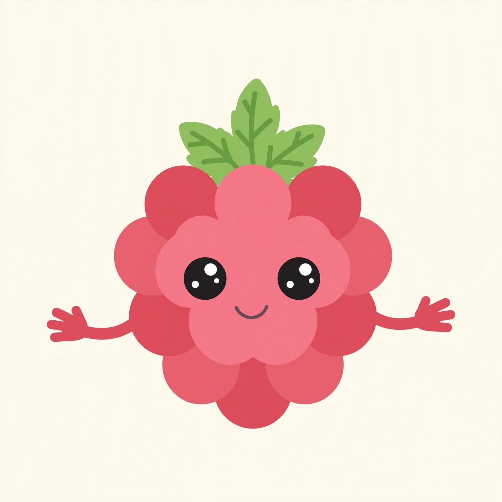
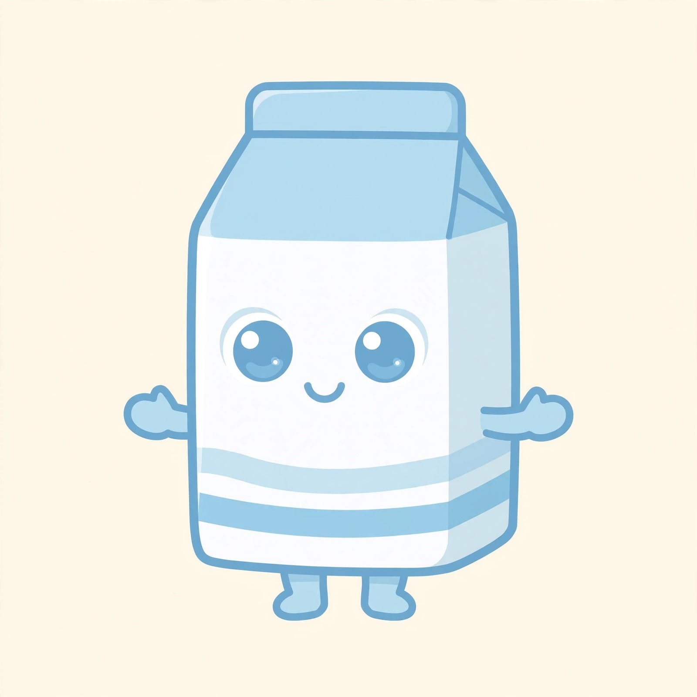
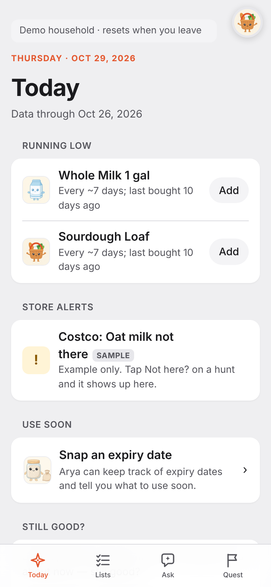
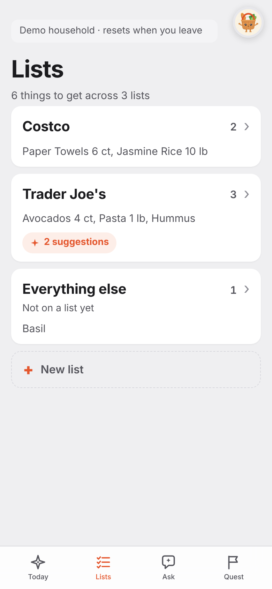
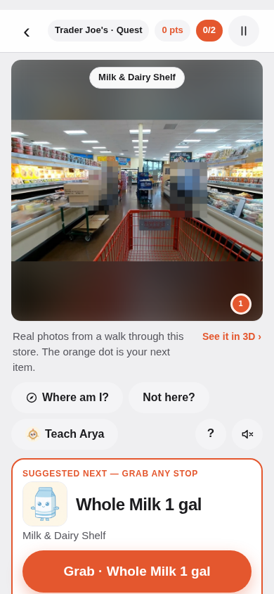

# Arya

**She remembers the list.** *(Winter is coming.)*

Groceries, sorted. Arya is a grocery list that learns. She keeps a
living model of your household's purchases (every receipt, every
return, every rhythm) so the list mostly writes itself: what is
running low, what to use soon, and which store you usually buy it at.
Think of it as Waze for grocery shopping. When you want it, the Quest
tab turns the shop into a treasure hunt through a model of your own
store; Express gives the same in-store help as a plain checklist. One
product, one app, one account.

   

**Quick links:** [Live demo](https://arya-pilot.duckdns.org) · [Pitch](docs/quest/PITCH.md) · [Game design](docs/quest/GAME-DESIGN.md) · [Design decisions](docs/quest/DISCUSSION.md) · [Submission map](docs/quest/SUBMISSION.md) · [Model policy](assistant/docs/MODEL-POLICY.md) · [Status](STATUS.md)

**Play her live:** https://arya-pilot.duckdns.org — "Try the demo"
opens a fictional household, no account needed. The whole loop is
there: Today shows what is running low, Lists hold your Costco and
Trader Joe's lists (add by typing, photo or voice), Ask Arya anything,
and the Quest tab hunts the Trader Joe's aisles and settles on a
receipt photo. Demo writes
live in a per-visitor sandbox; nothing reaches disk or another
visitor. The owner's data stays behind the owner's account.

## Meet the cast

Every item on your list has a face. Hers is a whole company of them:

  
  
  
  
  
  

## Her brain

- **Intake.** Receipts arrive as PDF or photo; Muse Spark reads
  them, and code checks every line against the printed total before
  anything posts. Lists arrive any way you think of them: a photo of
  a note or whiteboard, a paste, typing, voice — or your own
  assistant through the agent connector. Any MCP-capable agent
  (Muse Spark is the showcased client) reads and writes the list
  with your account token: Arya collects from the apps you already
  use instead of competing with them (`assistant/docs/AGENT-CONNECTOR.md`).
- **Ledger.** Kept purchases only: returns net out, bought-for-others
  is tracked but never suggested, discounts fold into their parent
  item.
- **Patterns and the judge.** Deterministic engines learn cadence
  and price by store. A Muse Spark staple judge gates what the
  pattern facts may put on the list — and since Oct 28 she has a
  second seat: Muse Spark Open (open weights, on Baseten) re-judges
  from item names alone, and every disagreement is kept as a
  curation signal. The Curator proposes product merges and splits;
  you apply them — no silent edits. The Resolver researches names
  Arya cannot place and shows its sources; you settle.
- **Eyes.** Show her the fridge, the pantry, the freezer. A photo
  produces sightings; you confirm before her model changes. What she
  has not seen, she calls unknown — never absent.
- **Ask Arya.** A chat grounded in a snapshot of her model. She
  answers from your data and applies stated facts as server-validated
  actions.

## Her game (Quest), opt-in

The list is the product; Quest is its own tab for when shopping
should feel like play. **List → Store → Play → Receipt.** Pick a
store from the directory (search by name, address or ZIP; favorites
first; add one with its address). A mapped store carries a model built from a shopper's
walkthrough video: VGGT builds the geometry, SAM 3.1 segments the
shelves, Muse Spark labels them, and every hunt stop sits at its
item's matched shelf.

Every person in every walkthrough frame is pixelated by SAM before
the frame ships — 476 shoppers, zero faces.

No map yet? In Quest she draws you an illustrated aisle and leads
anyway. Express is the same help as a plain checklist: Show me (the
shelf photo, only when you ask), Not here?, and Find with camera; no
points, badges or characters.
**Find it for me** aims your camera at one item: SAM 3.1 boxes it,
Muse Spark verifies it, and no picture of a person is ever kept.
Points bank only when the receipt settles — and every settled
receipt teaches her what your household actually eats. Design and
decisions: `docs/quest/`.

  
  
  

<em>Today, Lists, and a Quest hunt: the demo household, live build.</em>

## Measured results

- **Receipt photos — production reader (Muse Wonder 1.0, Spark
  fallback).** On the Gate 0 public set (9 receipts, 98 lines),
  through the production path: 97/98 lines with the right product
  and price after hand adjudication (98.98%; the automatic scorer
  gives 87/98), zero price errors, arithmetic 7/7. Muse Spark on
  the same hand adjudication: 92/98 (93.88%). Record: WONDER-EVAL.md
  in the research repo, `assistant/loops/2026-10-27-wonder-decode.md`.
- **Gate 0 — the photo gate (Muse Spark, before Wonder).** Public
  set 90/98 (91.84%, product identity + paid price), owner subset
  32/32, combined 122/130 (93.85%); strict-string 81.6%; arithmetic
  7/7. One silent price rotation got through; it is recorded, and
  the review queue is the mitigation. Record: GATE-REPORT.md in the
  research repo.
- **Open weights agree with her.** Muse Spark Open and hosted
  Spark labeled the same 32 grocery names independently: category
  agreement 100%, section agreement 100%. On the demo account's
  judged staples the second seat agreed 3 of 4 — the disagreement
  (Greek Yogurt: STAPLE by name, OCCASIONAL by purchase facts) is
  exactly why names advise and facts decide.
  `assistant/loops/2026-10-28-open-weights.md`.
- **"Where am I?" localizer** (written by Muse Wonder): 42/45 stops
  right, 45/45 within one stop, on held-out frames from the mapping
  video (frames half a second from indexed ones, never indexed
  themselves). It has not yet been measured on fresh shopper photos
  taken on another day.
- **Staple judge:** precision 0.79 against a purchase-cadence proxy
  on the owner's 114 receipts (eval method and disagreement lists
  in the research repo).
- **Owner corpus:** 114 receipts, 1,226 lines, 114/114 arithmetic
  match.
- **Tests:** 1,102 and green — `cd assistant && python -m unittest
  discover -s tests` (exact count in `STATUS.md`).

## How this was built

Everything in this repository was built during the hackathon build
window, which opened on Oct 27, 2026. The first commit is Oct 27,
15:13 ET. The engine (decode, dictionary, ledger, patterns, the
first PWA) was written by Muse Wonder in a separate spike session
that started on Oct 27, then committed here in stages over about 30
minutes; that is why the first commits arrive quickly. The loop
logs in `assistant/loops/` record each session. The household data
behind the owner's account (114 receipts back to 2023) is the
owner's purchase history, imported as data; it is not code.

## License

All rights reserved, see `LICENSE`. Third-party code and asset notes are in `NOTICE.md`.

## Rules that hold

Personal data is Standard mode only, enforced in
`api/meta_client.py` — and the open-weights client refuses personal
data in code. Costs are policy: `assistant/docs/MODEL-POLICY.md`.
Every door runs on Meta models — Muse in chat, Spark on the Meta
API in the app, Spark Open on Baseten for the platform-level jobs.
Documents are the source of truth: `assistant/docs/SPEC.md` and
`IMPLEMENTATION.md`; `STATUS.md` states where the build stands;
`docs/quest/` carries the hackathon doc pack (pitch, game design,
submission map). Agents: read `AGENTS.md` first.

Meta Global AI Developer Hackathon 2026 — Team Nightshift, Indie
track. Submission deadline: Nov 4, 2026, 9:00 PM ET.

*She remembers the list — so you don't have to.*
