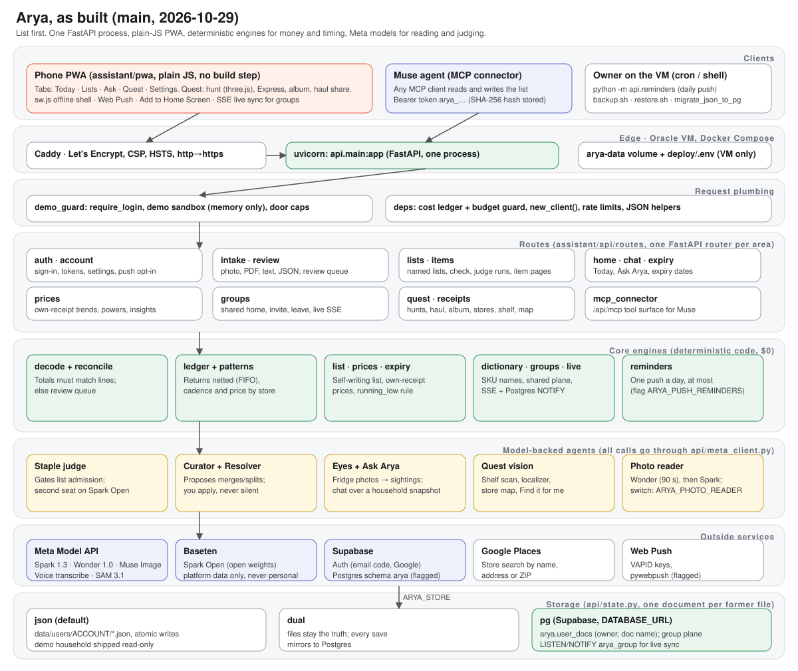

# Arya — Architecture (as built)

Status: living document, revised 2026-10-29. Section 0 is the one-page map with the diagram; sections 1 to 13 are the design record. SPEC.md states the product rules. This document states
how the built system is put together. Where the two disagree, SPEC.md
wins for behavior and this document wins for structure.

## 0. The whole app on one page

*The diagram is `assistant/docs/architecture.svg` (plain SVG, light and dark).
The sections below say what each box does. Facts here are checked against
`main` on 2026-10-29.*

**In one paragraph.** A phone-first PWA (plain JavaScript, no build step)
talks to one FastAPI process. Caddy fronts it with TLS. Code does the
money, timing and list logic at $0. Meta models read photos, judge
staples and answer questions, and every call to them goes through one
module (`api/meta_client.py`). State is one JSON document per area, kept
on a Docker volume, in Supabase Postgres, or both.

### 0.1 Front end (`assistant/pwa/`)

- Plain JS files loaded by `index.html`; no bundler, no framework. The
  shell is cached by `sw.js` (`CACHE` is bumped, and new files are added
  to `SHELL`, whenever the shell changes).
- Five tabs: **Today**, **Lists**, **Ask**, **Quest**, **Settings**.
  Settings opens the Profile page (account, Group, Reminders, Arya's
  powers, Add to Home Screen, feedback).
- Per area: `lists.js` (named lists, add row), `aryaask.js` and
  `huntask.js` (Ask Arya), `quest.js` with `scene.js`, `huntmenu.js`,
  `pack.js`, `album.js`, `haul.js`, `share.js`, `mapper.js` (hunts, the
  three.js store model, Express checklist, haul photo), `expiry.js`,
  `group.js` (shared home and the live stream), `push.js`, `powers.js`
  (price powers and the daily "Did you know?" card), `a2hs.js` (install
  prompt on Android and desktop, four steps on iPhone).
- Security: one inline theme script allowed by its SHA-256 hash in the
  CSP (`tests/test_csp.py` keeps the hash in step); every other script is
  a file; no inline handlers.
- Style: light theme, greyscale structure and one orange accent; see
  `DESIGN.md`.

### 0.2 API (`assistant/api/`)

`api/main.py` is about 55 lines: the app, the `require_login` middleware,
a handler that turns a model failure (`RuntimeError`) into a 502 with a
plain sentence, `/health`, one ordered router list, and the static mount
for the PWA. Routes live in `api/routes/`, one router per area:

| Router | What it serves |
|---|---|
| `auth`, `account` | sign-in, registration (closed unless `ARYA_REGISTRATION_OPEN=1`), email code and Google (flagged), connector token, settings, export, feedback, push opt-in |
| `intake`, `review` | receipt photo, PDF, text, order text, structured JSON, Costco JSON, voice transcribe, Curator, review queue |
| `lists`, `items`, `expiry` | named lists, add by text or photo, check, move, judge runs, item pages and flags, expiry dates |
| `home`, `chat` | the Today payload, Ask Arya and its apply step |
| `prices` | own-receipt prices, Analysis insights, Arya's powers |
| `groups` | shared home: create, invite, join, leave, live stream |
| `quest`, `receipts`, `shelf`, `storemap`, `stores`, `avatar`, `friends` | hunts, receipts with originals, shelf scan and "Where am I?", Map my store, store directory, avatar, friends |
| `mcp_connector` | `/api/mcp`, the tool surface for a Muse agent |

Older siblings stay beside the package: `album_routes`, `hunt_routes`,
`haul_routes`, `pack`. Shared plumbing is in `api/deps.py` (cost ledger,
budget guard, `new_client()`, rate-limit buckets, JSON helpers) and
`api/demo_guard.py` (login middleware, demo sandbox, door caps).

### 0.3 Engines in code ($0)

`decode/service.py` (PDF text layer, scanned PDF pages rendered with
`pypdfium2` and sent to the photo reader, arithmetic reconcile),
`ledger/` (returns netted FIFO, allocations), `patterns/` (cadence and
price by store), `list/` (the derived list and its reasons),
`state.running_low` (one rule for Today and Ask), `prices.py` (see §0.7),
`expiry.py`, `dictionary/`, `optimizer.py` (merges duplicate adds and fixes typos before a hunt) and `cart/` (a sandbox cart proposal; approval is a state change only, and the app no longer shows it).

### 0.4 Models

All calls go through `api/meta_client.py`; the personal-data rule is
enforced there. `open_client.py` is the only other model client.

| Job | Model | Notes |
|---|---|---|
| Reasoning, decode fallback, judge, Curator, Eyes, Ask Arya | `muse-spark-1.3` (Standard) | cached prefixes, low effort |
| Receipt photo reader (default) | `muse-wonder-1.0`, 90 s bound | any failure falls back to Spark; `decoded_by` records which read it |
| Receipt photo reader after Nov 4 | Spark | set `ARYA_PHOTO_READER=spark` in `deploy/.env` and rebuild; no code change |
| Avatar and look images | `muse-image-1.0` | |
| Voice in | `muse-voice-transcribe-1.0` | |
| Shelf and people segmentation | `sam-3.1` | every person in a stored frame is pixelated first |
| Second judge seat, dictionary enrichment | Spark Open on Baseten | platform data only; the client refuses personal data |

### 0.5 Storage

`api/state.py` keeps one JSON document per former file (receipts,
dictionary, flags, lists, quest, push...). `ARYA_STORE` picks the
backend: `json` (default; files under `data/users/<account>/`),
`dual` (files are the truth, each save mirrors to Postgres) or `pg`
(Supabase table `arya.user_docs`, keyed by owner and document name,
role `arya_app`, via `DATABASE_URL`). The demo account always uses files,
and its visitors write only to an in-memory sandbox overlay. Caches and
big blobs (`shelf_matches.json`, `storemap_img.json`) stay on disk in
every mode. A receipt's original photo or PDF is kept per account.

### 0.6 Auth

Password accounts (PBKDF2 hashes, throttled sign-in, cookie sessions
whose tokens are stored as SHA-256 hashes). Account names allow only
letters, digits and `. _ % + - @`. Supabase Auth (email code and Google)
only proves an email address; Arya keeps its own account and cookie
(`api/supabase_auth.py`, flag `ARYA_SUPABASE_AUTH`). The Muse connector
uses a bearer token whose hash is stored.

### 0.7 Price intelligence

`api/prices.py` is deterministic and uses only the household's own
receipts: per-store unit prices, a cheaper-store hint when the gap is
real, a trend only with enough buys over enough days, the household's own
basket inflation, a split-the-list suggestion, food waste in dollars.
Nothing is fetched from a store, a flyer, an API or the web. Ask Arya
answers price questions from these precomputed facts. Community prices,
Deals and Arya Shoppers are opt-in, recorded only, and not live.

### 0.8 Groups and live sync

With `ARYA_GROUPS=1` (on in compose), an account in a group reads and
writes the shared stores (lists, flags, product knowledge) in the group's
plane; receipts stay with the account that filed them and every member
sees them. Invites are a 6-letter code valid 48 hours. Leaving copies
the lists. Live sync: every shared save calls `live.changed(group_id)`;
each open app holds one Server-Sent Events stream (`/api/group/live`)
and reloads when its group changes. With `DATABASE_URL` set the change is
a Postgres `NOTIFY arya_group` and one listener thread per process wakes
its streams; without it, or with `ARYA_LIVE_PG=0`, the wake stays
in-process.

### 0.9 Push reminders

Flag `ARYA_PUSH_REMINDERS=1` plus VAPID keys. A phone opts in from
Settings; the subscription is saved in `push.json`. A daily cron line
runs `python -m api.reminders`, which sends at most one push per account
per day for staples that run out inside the notice window. No model
calls. Steps: `PUSH-REMINDERS.md`.

### 0.10 Deploy

One Oracle VM, Docker Compose with two services: `api` (uvicorn,
`deploy/Dockerfile.api`) and `caddy` (TLS, security headers, CSP, plain
HTTP redirects to HTTPS). Data lives in the `arya-data` volume. Settings
come from `deploy/.env` (VM only); compose lists every variable the app
reads, and `tests/test_compose_env.py` fails if one is missing. Deploy is
`git pull` then `docker compose up -d --build` in `assistant/deploy`
(`deploy.sh`); never rsync `--delete`. `backup.sh` and `restore.sh`
handle the nightly backup. CI is manual only
(`.github/workflows/tests.yml`).

### 0.11 Feature flags and settings

| Variable | Default in compose | Effect |
|---|---|---|
| `ARYA_STORE` | `json` | `json`, `dual` or `pg` storage |
| `DATABASE_URL` | empty | Supabase Postgres connection (role `arya_app`) |
| `ARYA_GROUPS` | `1` | shared households (code default is off) |
| `ARYA_LIVE_PG` | `1` | live sync through Postgres NOTIFY when `DATABASE_URL` is set |
| `ARYA_PUSH_REMINDERS` | `0` | push reminders; needs `ARYA_VAPID_*` keys |
| `ARYA_SUPABASE_AUTH` | `0` | email code and Google sign-in; needs `SUPABASE_URL`, `SUPABASE_ANON_KEY` |
| `ARYA_SUPABASE_SIGNUP` | `1` | `0` limits Supabase sign-in to existing accounts |
| `ARYA_REGISTRATION_OPEN` | `0` | open password sign-up |
| `ARYA_PHOTO_READER` | `wonder` | receipt photo reader; `spark` from Nov 4 |
| `ARYA_DAILY_BUDGET_USD` | `10` | app model-spend ceiling per day |
| `ARYA_DEMO_DAILY_BUDGET_USD` | `2` | demo household's day bucket |
| `ARYA_DEMO_SESSION_BUDGET_USD` | `0.40` | one demo visit's share |
| `ARYA_DEMO_DOOR_RATE`, `ARYA_DEMO_AUTH_RATE` | `240`, `120` | per-IP demo door and auth rate limits |
| `ARYA_FEEDBACK_DAILY_CAP` | `5` | feedback messages per account per day |
| `MODEL_API_KEY`, `BASETEN_API_KEY`, `ARYA_OPEN_MODEL`, `GOOGLE_PLACES_API_KEY` | empty | model keys and the store picker |

### 0.12 Cost guards

Every model call writes a row to the cost ledger. The app, the demo
household and each demo visit spend from separate buckets (§10). Live
doors, batch judge runs and hunt creation pass the guard first; the
demo's live doors also have per-IP caps. Deterministic code never calls a
model.

## 1. The shape: two layers

Arya has two layers. Each layer does the work it is good at.

- **The edge** is the user's own Muse. It sees the media: receipt
  photos, PDFs, pasted orders, fridge photos. It reads them and sends
  Arya structured data only; on this path no receipt image reaches the
  server. A receipt photo filed in the app itself is kept per account
  and is viewable in the app ("View receipt", Discussion 42). This is
  an accepted trade-off, recorded in SPEC.md.
- **The core** is the Arya server. It verifies, remembers, reasons, and
  answers. It spends no tokens on reading media.

The rule between the layers: **the client proposes, Arya disposes.**
Client data is untrusted. Totals must reconcile in code before a receipt
is accepted. Low-confidence lines go to the review queue.

## 2. Intake paths

All paths end in one contract: a decoded receipt with lines, subtotal,
tax, and total.

1. **Structured intake (primary).** POST /api/intake/structured. The
   user's Muse posts the decoded receipt as JSON. The server recomputes
   every line status; a subtotal that does not match the lines fails
   reconciliation and is marked, never silently accepted.
2. **Order text.** POST /api/intake/order-text. A pasted online order
   (Instacart, Amazon) is extracted server-side, then follows the same
   path. Delivery fees and tips are excluded by rule.
3. **Server decode (fallback).** PDF text and photo decode endpoints
   remain for clients that cannot decode at the edge. They use the
   Model API under the model policy (MODEL-POLICY.md).
4. **Costco JSON export.** Bootstrap seed only. It is not a product
   intake path.

## 3. Verification in code (no model, no cost)

- Arithmetic: line totals must sum to the subtotal within 5 cents.
- Line status: auto at confidence 0.8 or above, else unverified and into
  the review queue.
- **Discount lines are structure, not identity.** A discount line
  (Costco prints it as "/<item number>") attaches to its parent item —
  named on the receipt, else the previous item line — and is always
  auto-verified. It never enters the review queue, on any path.
- Fee lines are classified once and never enter patterns or the list.

## 4. Identity: what things are

Three mechanisms, in order of strength.

1. **The dictionary** maps each store SKU to a canonical name. A name the
   user confirms teaches the dictionary. An item whose name cannot be
   established is **unresolved**: off the list, out of patterns, waiting
   in the review queue. Arya never guesses a name.
2. **Groups.** Products are grouped by an explicit group key when one is
   set, else by their normalized name. Costco re-SKUs the same product
   under one name; the group is the product everywhere it matters —
   patterns, ledger, list. Merges and splits set the explicit key.
3. **The Curator** (server-side reasoning) proposes merges and splits
   inside candidate clusters built in code at no cost. The model judges
   a cluster under a strict doctrine: same product only; never across
   organic vs conventional, form, flavor, fat content, or a size that
   makes a different product; when in doubt, keep separate. **A proposal
   changes nothing until the user applies it. No silent edits, ever.**
   Proposals the dictionary has already overtaken (members already one
   group, a duplicate, a split already in effect) retire automatically
   as *superseded* and are never shown.

## 5. The Resolver: research at the edge

Arya's server models have no web access. Identification from the outside
world is therefore an edge job, run by the user's Muse:

- Trigger: an unresolved dictionary item, or an unverified receipt line
  whose name is abbreviated or unreadable.
- Method: the retailer's own catalog first. A store item number matched
  on the retailer's site (for Costco: costco.com and its same-day
  storefront) is the strongest evidence. Then the wider web.
- Output: candidates **with source URLs**, posted to Arya
  (POST /api/review/suggest) and shown in the review queue next to the
  item or line. Research is evidence, not a verdict: the user settles
  with one tap, and settling teaches the dictionary.
- A brand initial alone is not evidence. Items with no catalog match
  stay open.

## 6. The reasoning agents in the core

Each agent has a narrow job and a named limit.

- **Staple judge.** Input: pattern facts only (buys, cadence, quantities
  — computed in code). Output: STAPLE, SEASONAL, OCCASIONAL, ONE_OFF, or
  NOT_CONSUMABLE per product. The verdict gates admission to the list.
  Explicit user intent always beats the judge. Unjudged and unresolved
  items stay off the list.
- **Curator.** See §4. Proposes identity changes; never applies them.
- **Eyes.** Fridge, pantry, and freezer photos filed at the edge become
  sightings. A sighting is pending until the user confirms it. Unseen is
  unknown: Eyes never edits inventory on its own.
- **Ask Arya.** Chat over a household snapshot. Actions (add to list,
  ran out, mark expired, never suggest, snooze) are validated
  server-side. Numbers come from the data, never from the model. On the
  Ask tab actions apply at once; from a list or a hunt, adds apply with
  Undo and the riskier actions (out, expired, never, snooze) wait for a
  yes (`/api/chat/apply`). Demo sessions can chat; it is a live door
  under the demo's per-IP and per-visit caps (§10).

## 7. Money rules (summary; SPEC.md owns the detail)

- Returns are first-class: FIFO netting against buys, refunds reconcile
  into spend, patterns count kept items only, a returned item is never
  re-suggested.
- Every line carries an allocation: HOUSEHOLD (default) or FOR-OTHERS.
  For-others spend is in the ledger, never in patterns, inventory, or
  the list.
- The list is a derived view of the inventory model, never the source
  of truth.

## 8. Accounts, tokens, and the connector

- Per-user state is a set of JSON documents, one per former file
  (receipts, dictionary, flags, lists, quest...). `ARYA_STORE` picks
  where they live: `json` (files under data/users/<account>/, the
  default), `dual` (files are the truth, every save is mirrored to
  Postgres), or `pg` (table `arya.user_docs`, see `api/pgstore.py`).
  The demo account always stays on files.
- An account name is also a folder name, so it holds only letters,
  digits and `. _ % + - @` (`auth.valid_name`). Passwords are PBKDF2
  hashes; sign-in is throttled; sessions are cookies, and session
  tokens are stored as SHA-256 hashes.
- Email code and Google sign-in (Supabase Auth) are built behind
  `ARYA_SUPABASE_AUTH=1`, off by default. Supabase only proves the
  email; Arya keeps its own account (named by the email, no password)
  and its own cookie (`api/supabase_auth.py`).
- A connector token is `arya_` plus a random secret. **Only its SHA-256
  hash is stored.** It is shown once at mint; minting a new one replaces
  the old; it can be revoked at any time. Bearer tokens are accepted
  alongside session cookies. Demo accounts cannot mint.
- The Muse connector (custom.arya) carries its own instruction doc:
  operations, when to file, the verification rules, the Resolver
  procedure, filing hygiene. **The doc is the standing prompt.** The
  user writes no prompt.
- Routing is contextual. A receipt, an order, or a question about the
  user's own list, spend, or inventory goes to Arya. A general question
  does not. "Arya, …" always routes. Ambiguous input: ask, or state
  the assumption.

## 9. Onboarding

1. Create an account. A new account opens on Today; there is no
   Connect Muse step on first run.
2. Connecting Muse is optional, from Profile > Connect Muse: mint the
   token there (shown once).
3. Add the Arya connector in Muse; paste the token into the secure
   form. Never into a chat message.
4. Talk to Muse. Profile > Connect Muse carries these steps and a
   copyable fallback setup prompt for assistant apps that do not load
   the connector doc automatically.

## 10. Cost control

- MODEL-POLICY.md is normative: deterministic work in code at $0;
  Spark 1.3 Standard, low effort, cached prefixes for volume reasoning;
  Contributor for evaluation and synthetic data only — never personal
  data; Wonder is banned from volume paths.
- Every model call is written to a cost ledger. The app's daily
  ceiling (`ARYA_DAILY_BUDGET_USD`, $10) stops app model spend; the
  demo household spends from a separate bucket
  (`ARYA_DEMO_DAILY_BUDGET_USD`, $2/day) and each demo visit from its
  own share (`ARYA_DEMO_SESSION_BUDGET_USD`, $0.40), so demo use cannot
  drain the app. Every live door, batch judge run and hunt creation
  passes the guard first.
- A model answer that cannot be read is a 502 with a plain sentence,
  never a 500 (`meta_client.parse_json`). Per-user spend caps are required before public registration
  opens; they are not yet built.
- api/meta_client.py is the only module that calls the Model API. The
  personal-data rule is enforced there by construction.

## 11. Deployment

- One Oracle VM (Always Free; no new cloud resources). Docker Compose:
  the API and Caddy with Let's Encrypt. No database container: data is
  JSON files, or Supabase with `ARYA_STORE`. Public name:
  arya-pilot.duckdns.org, with a DuckDNS updater on the VM.
- Deploy is `git pull` on the VM, then a compose rebuild. Never
  rsync --delete: it once deleted the VM-only deploy environment.
- Settings come from `deploy/.env` (VM only). Compose passes only the
  variables it lists, so every setting the app reads is listed in
  `docker-compose.yml`; `tests/test_compose_env.py` fails if one is
  missing. `.env.example` names them.
- The test suite runs before every commit. A GitHub Actions workflow
  (`.github/workflows/tests.yml`) runs it on demand only, not on
  every PR (owner's choice). Small commits to main, named by
  stage; a session log goes to loops/ and STATUS.md is updated.

## 12. Quest storage

Per account, in `quest.json`: sessions, Shop-Offs, friends, Spotter
reports, and sightings (item, store, shelf label, time; no image).
`shelf_frames.json` holds one fresh shelf photo per store and item,
already scrubbed of people by SAM (`shelfscan.scrub_people`; no scrub,
no frame). `GET /api/quest/plan` counts purchases per store from the
ledger for Plan a hunt ($0). The demo sandbox overlays all of it in
memory. The store directory (`stores.json`) is platform-level.

## 13. Not built / held

- Per-user spend caps (§10) — required before registration opens.
- Public registration — closed. The plan: open after the hackathon,
  once per-user spend caps exist (§10). Intake is not Muse-only:
  every door runs on Meta models — Muse in chat, Spark on the Meta
  API in the app.
- Forgot-password — not built. Once switched on, email code sign-in
  (§8) lets a person in without a password.
