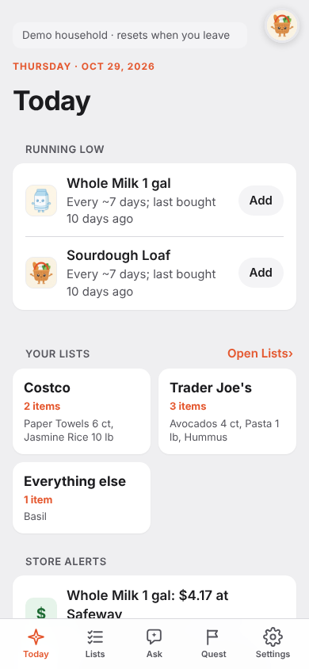
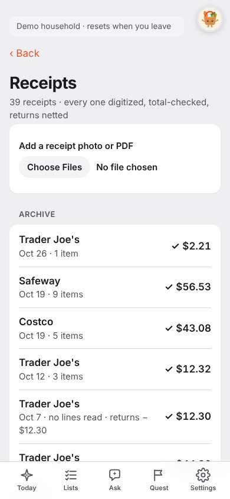
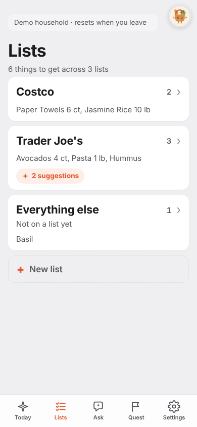
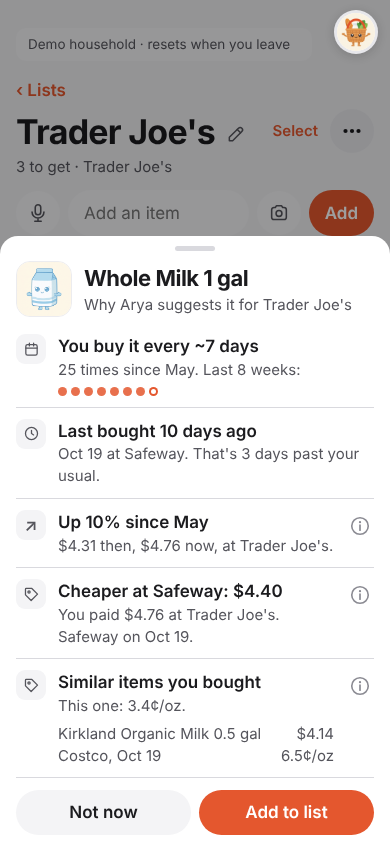
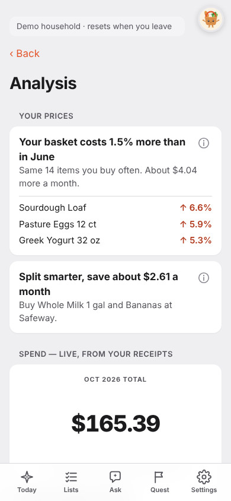
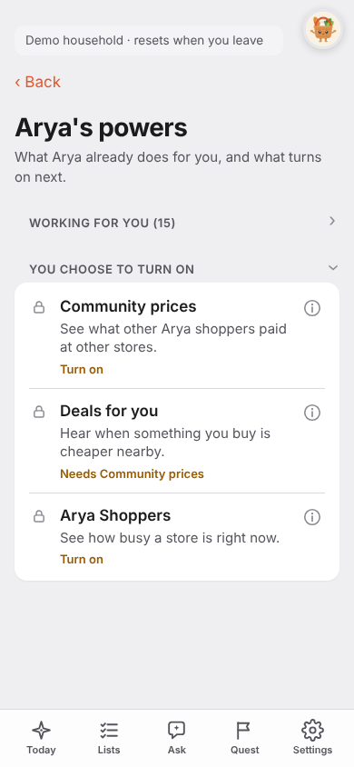

# Arya user journeys

Seven journeys, from the first receipt to a shared household. Each one
has a person, a goal, the screens in order, and sample data. The numbers
come from the demo household (`python -m harness.make_demo_household
data`), so you can open the live demo and see the same thing.

Product line: Arya is "Waze for grocery shopping". The list comes first.
The Quest hunt is optional.

## How to read this page

**Status tags**

| Tag | Meaning |
|---|---|
| Shipped | On `main` and in the demo. |
| Shipped, flag | On `main`, but a setting keeps it off until the owner turns it on. |
| Needs a model | Works only when `MODEL_API_KEY` is set. The demo uses the key on the VM. |
| Planned | Not built. Listed so nobody thinks it is there. |

**The demo household.** The fictional Sharma family. 39 receipts from
May 2 to Oct 24, 2026: Trader Joe's 18, Costco 12, Safeway 9. Total
spend is $1,115.42. That is $1,090.42 of groceries, plus a $25.00 gift
card (bought for someone else). One chicken was returned for $12.30.
The demo slides all dates to the current week. The screenshots were
taken on Oct 29, 2026, so a date such as "Oct 19" in a picture is a
seed date moved forward. Money amounts never move.

**Where prices come from.** Every price in this page comes from the
household's own receipts. Arya does not scrape stores. It does not call
store APIs, read flyers or search the web for prices.

**Screenshots** are real 390x844 captures of the demo, in
`assistant/docs/img/`.

---

## Journey 1. First receipt, and the list starts to write itself

**Person.** Priya Sharma. She shops every Saturday. She writes lists in
her head and forgets milk.

**Goal.** Put in last week's receipts and see what Arya learns.

**Status.** Shipped. Reading the photo or PDF needs a model.

| Step | What Priya does | What Arya shows |
|---|---|---|
| 1 | Opens the app, taps **Try it now** or creates an account. | Landing: "Your grocery run, smarter." Three real rows (Whole Milk "Running low"). |
| 2 | Lists, **Receipts** (the group at the bottom), **Add receipts**. She picks the Costco PDF from Oct 17. More than one file is fine. | One progress line per file, then one summary: filed, already filed, could not read. |
| 3 | Waits a few seconds. | Muse Spark reads the lines. Code adds them up. The receipt shows a check mark and its total only if the lines match the printed total. |
| 4 | Files the same PDF again by mistake. | "Already filed." Arya compares a fingerprint (store, date, lines, total) and does not count the trip twice. |
| 5 | Wants one old receipt. In **Receipts**, types the store in the search box, opens **Date** and picks a range, and picks **Store A to Z** or **Highest total** in **Sort**. | A line shows how many receipts match and their total. **Clear** removes the filters. |
| 5 | Opens **Today**. | **Running low** lists items that are due. |

**Sample data: the Costco receipt, Oct 17**

| Line | Price |
|---|---|
| Pasture Eggs 12 ct | $6.47 |
| Jasmine Rice 10 lb | $13.49 |
| Paper Towels 6 ct | $9.99 |
| AA Batteries 8 ct | $8.99 |
| Kirkland Organic Milk 0.5 gal | $4.14 |
| **Total** | **$43.08** (the lines add up, so it posts) |

**What she learns on Today.** After 26 Saturdays the pattern for Whole
Milk is clear: "Every ~7 days; last bought 10 days ago", window Oct 24
to Oct 27. Sourdough Loaf has the same line. Each row has an **Add**
button.

**The rules behind it**
- A pattern needs 3 kept buys before Arya calls an item "running low".
- Returns count as not bought. The returned chicken (Oct 5, $12.30)
  never comes back as a suggestion.
- Bad lines go to a review queue. Nothing posts in silence.
- The gift card is tracked under "Bought for others". It is never
  suggested.

---

## Journey 2. Plan a Costco and Trader Joe's trip

**Person.** Priya, on Friday evening.

**Goal.** One list per store, with the usual things already there.

**Status.** Shipped. Typing and tapping are code. Voice and photo adds
need a model.

| Step | What Priya does | What Arya shows |
|---|---|---|
| 1 | Taps **Lists**. | Cards: **Costco** (2 items), **Trader Joe's** (3 items), **Everything else** (1 item). |
| 2 | Opens **Trader Joe's**. | Avocados 4 ct, Pasta 1 lb x2, Hummus. Under them, suggestions from her patterns for this store. |
| 3 | Types "mlik" in the add row and taps **Add**. | The add applies at once, with Undo. Arya links the typed name to the tracked item, so "mlik" becomes Whole Milk 1 gal. |
| 4 | Taps Whole Milk to see why. | The **why sheet** (below). |
| 5 | Swipes Basil to **Move**. | Basil goes to the Trader Joe's list. She can use **Select** to move many items. |
| 6 | Taps the pencil by the list name. | The name edits in place. |

**Sample data: lists after the setup**

| List | Items |
|---|---|
| Costco (store: Costco) | Paper Towels 6 ct, Jasmine Rice 10 lb |
| Trader Joe's (store: Trader Joe's) | Avocados 4 ct, Pasta 1 lb (x2), Hummus |
| Everything else | Basil |

**The why sheet for Whole Milk** shows Arya's reasons in plain words:
"You buy it every ~7 days. 25 times since May." "Last bought 10 days
ago. That is 3 days past your usual." Price lines follow in Journey 4.

**Also on this screen**
- Typing "milk" finds "Whole Milk". Typing a non-grocery item, for
  example "light bulbs", keeps it under Other errands.
- Items you add are not changed without your tap. Riskier changes
  (out of stock, never again, snooze) ask first.
- Planned: none for this journey.

---

## Journey 3. In the store with Quest

**Person.** Priya, Saturday at Trader Joe's.

**Goal.** Get everything on the list without walking back.

**Status.** Shipped. A quest needs no model. "Find it for me" needs one.
Express, the plain-checklist mode, no longer has an entry point; its
screen stays only for runs started before it was removed.

| Step | What Priya does | What Arya shows |
|---|---|---|
| 1 | Opens the Trader Joe's list. Taps **Start shopping · 3 items**. | A first-time how-to: Find it, Grab it, Snap the receipt. A list with no items sends her to Add items instead. |
| 2 | Taps **Got it**. | "Trader Joe's · Quest", a points counter, "0 of 3". The store's layout is labelled as a typical layout until shoppers map it. A card says "Pasta 1 lb x2, Pasta Shelf". |
| 3 | Taps **Grab**. | +10 points. She can put an item back. |
| 4 | An item is not on the shelf. She taps **Not here?** and confirms. | The report shows as a store alert for other shoppers. |
| 5 | Taps **Find it for me** and aims the camera at a shelf. | SAM 3.1 boxes candidates, Muse Spark checks each one, and the match lights up for one tap. |
| 6 | Taps **I'm done shopping**, then photographs the receipt. | +50 points. The receipt is filed with the same checks as Journey 1. |

**Rules.** No clock. No lives. No way to lose. Quest is optional; the
list works without it.

**Sample data.** "Trader Joe's · Quest", 3 items on the card: Avocados 4
ct, Pasta 1 lb x2, Hummus.

---

## Journey 4. Compare prices from my own receipts

**Person.** Arjun Sharma, who pays the bills and wants to spend less.

**Goal.** Find out where milk is cheaper, and what has gone up.

**Status.** Shipped. Arya uses only the household's own receipts.
Community prices, **Deals** and **Arya Shoppers** are Planned: today the
opt-in choice is saved and nothing else is built. There are no price
charts. Trends show as words and percent.

| Step | What Arya shows | Where |
|---|---|---|
| 1 | "Whole Milk 1 gal: $4.17 at Safeway. You usually pay $4.56 at Trader Joe's." | Today, **Store alerts** |
| 2 | "Up 10% since May. $4.31 then, $4.76 now, at Trader Joe's." | Whole Milk why sheet |
| 3 | "Cheaper at Safeway: $4.40. You paid $4.76 at Trader Joe's. Safeway on Oct 19." | Whole Milk why sheet |
| 4 | "Similar items you bought. This one: 3.4 cents/oz. Kirkland Organic Milk 0.5 gal, $4.14, Costco, 6.5 cents/oz." | Whole Milk why sheet |
| 5 | The **(i)** button on each line gives the small print, for example how many buys the number comes from. | Why sheet |

**Sample data: milk price by store (own receipts)**

| Store | Buys | Median | Last |
|---|---|---|---|
| Trader Joe's | 16 | $4.54 | $4.76 |
| Safeway | 9 | $4.17 | $4.40 |

Eggs are different. Arya has 12 Costco buys (median $6.03, last $6.47,
up 17% since May) and one Trader Joe's buy at $6.96. It shows no "cheaper
at" line, because there is no better store in the data.

**Spending, "Your prices over time"** (the Spending page, called Analysis before the labels audit)

| Card | What it says |
|---|---|
| Your basket | "Your basket costs 1.5% more than in June. Same 14 items you buy often. About $4.04 more a month." Movers: Sourdough Loaf +6.6%, Pasture Eggs +5.9%, Greek Yogurt +5.3%. |
| Split smarter | "Save about $2.61 a month. Buy Whole Milk 1 gal and Bananas at Safeway." Milk $1.48, bananas $1.13. |
| Spend | Oct 2026 total $165.39. By store: Trader Joe's $453.55, Safeway $396.21, Costco $265.66. Top item: Chicken Breast, $152.21. |

**Arya's powers.** Settings, About Arya, has a page that lists what Arya already
does and what turns on next, with one line per power. One "Did you
know?" line shows on Today each day.

**Limits.** Arya says "your prices" and never "the store's price". With
no receipt for an item at a store, it makes no claim for that store.
Spark never finds or guesses a price.

---

## Journey 5. A household with Groups

**People.** Priya and her partner Arjun, each with an own account on an
own phone.

**Goal.** One shared set of lists and receipts. A clean way out.

**Status.** Shipped, on by default in `docker-compose.yml`
(`ARYA_GROUPS=1`, PR #128). Set `ARYA_GROUPS=0` in `deploy/.env` to turn
it off. The demo household cannot join a group, so this journey needs
two real accounts. It needs a deploy before the live site has it.
Live sync uses Postgres LISTEN/NOTIFY when `DATABASE_URL` is set.
It has not been tried against the Supabase session pooler. If the
pooler refuses it, set `ARYA_LIVE_PG=0`.

| Step | Who | What happens |
|---|---|---|
| 1 | Priya | Settings, **Start a group**, names it "Sharma home". Her lists become the group's lists. She is the owner. |
| 2 | Priya | Taps **Invite someone**. Arya shows a 6-character code, for example `K7M2QX`. It lasts 48 hours. Any member can make one. A group holds up to 6 people. |
| 3 | Arjun | Opens **Join a group**, types the code. Arya shows a preview first: who invited, how many people, how many lists. |
| 4 | Arjun | Joins. His lists merge into the group's. Lists with the same name become one list. Both people now see Costco and Trader Joe's. |
| 5 | Arjun | Adds Hummus to Trader Joe's in the aisle. |
| 6 | Priya | Her open list reloads in about a second. A tab skips the echo of its own change. |
| 7 | Both | Receipts from both accounts show in **Receipts**, tagged with the person who filed each one. |

**Leaving**

| Step | What happens |
|---|---|
| 1 | Arjun taps **Leave group**. The sheet says: "You keep a copy of the lists and your own receipts." |
| 2 | He taps **Leave group** again. |

| Data | After he leaves |
|---|---|
| Lists | Duplicated. Arjun has a copy. The group keeps its own. |
| Receipts | Belong to the account that filed them. Each goes with its owner. |
| Running low, patterns, spend | Recomputed for both sides from the receipts each side now has. |
| Personal items (profile, badges, Quest, push, currency) | Never shared, so nothing changes. |

If the owner leaves, the member who joined first becomes owner. When the
last member leaves, the group is gone.

**Not planned.** Roles, per-list privacy, kids' accounts.

---

## Journey 6. Expiry dates and Use soon

**Person.** Priya, unpacking the Saturday shop.

**Goal.** Use the spinach before it turns.

**Status.** Shipped. Reading a date from a photo needs a model. In the
demo, a canned sample read stands in for the photo.

| Step | What Priya does | What Arya shows |
|---|---|---|
| 1 | Taps **+ Snap a date** on Today, then photographs "USE BY OCT 31" on the spinach. | Spark reads the date. Arya shows what it read: "Baby Spinach 16 oz, use by Oct 31". |
| 2 | Taps **Looks right, track it**. | Nothing is saved until she confirms. The photo is never kept. |
| 3 | Looks at Today three days later. | **Use soon** shows Baby Spinach 16 oz with the days left. It shows items up to 7 days ahead. A past date stays for 7 days, then fades. |
| 4 | Taps the row in Use soon. | She can snooze it (it waits 2 days), fix the date or stop tracking. |
| 5 | Buys spinach again. | A new receipt means a new package, so the old date drops. |

**Still good?** Arya asks by itself when an item "usually turns about
now". The demo shows **Still good? · 3 to check**: Baby Spinach 16 oz,
Chicken Breast and 1 more. Priya taps **Still good** or **It expired**.
This part is code, not a model.

**Rule for a past date.** A past date is neutral ("your call"), not a
red alarm.

---

## Journey 7. Ask in the aisle, a reminder, and the Home Screen

**Person.** Priya, in the week.

**Goal.** Get answers without opening a spreadsheet, and get a nudge
before milk runs out.

### 7a. Ask Arya

**Status.** Shipped. **Needs a model.** Without `MODEL_API_KEY` the
Ask tab says it could not answer.

In the Ask tab Priya can type, or tap **Talk** to speak. Arya answers in text only:

| She says | Arya does |
|---|---|
| "We finished the Greek yogurt." | Applies the change and the list updates. |
| "What do we spend on coffee?" | Answers from the ledger (Coffee Beans 12 oz, $104.80 over 26 weeks in the demo). It does not invent a number. |
| "Where is milk cheaper?" | Reads the price facts that code computed from her receipts (see Journey 4). The model only reads them. |
| "What is Arya?" | Answers about Arya itself. |
| A photo (Photo chip under the Ask field) | Opens a chooser over the existing readers (list, receipt, fridge, expiry date), or "Ask about this photo" once. The photo is not stored. |

**During a hunt** a bar "Ask Arya..." sits at the bottom. It opens a
sheet with three quick questions: "Where's the {item}?", "Is there a
cheaper one?", "I can't find it". The sheet knows the store, the item
on screen and what is left, so "this" and "it" work.

### 7b. Push reminder

**Status.** Shipped, **flag**. It is off until the owner sets
`ARYA_PUSH_REMINDERS=1`, makes VAPID keys and adds a daily cron line
(see `assistant/docs/PUSH-REMINDERS.md`). Demo accounts never see it.

1. Settings, Preferences, **Remind me**. Priya turns it on and picks the notice
   window (1 to 7 days, default 2).
2. At 9:00 the daily job runs. It sends at most one push per account
   per day. No model call. $0.
3. Example push, one item: **"Whole Milk 1 gal is probably running
   out"** with "Add it to this week's list? Tap to open your list."
4. Example push, several: **"3 things are about to run out"** with
   "Whole Milk 1 gal, Sourdough Loaf, Pasture Eggs 12 ct. Tap to see
   them."
5. A cycle is announced once. A new receipt starts a new cycle.

On iPhone, reminders work only after Add to Home Screen (iOS 16.4 or
newer).

### 7c. Add Arya to the Home Screen

**Status.** Shipped (PR #133). Hidden in the demo and once Arya runs
from the Home Screen.

| Phone | What happens |
|---|---|
| Android and desktop Chrome | A card at the top of Today: **Add Arya to your Home Screen. Full screen, with reminders.** The **Install** button runs the browser's own prompt. |
| iPhone | The card says **Show how**. It opens 4 steps, including "leave Open as Web App on". Off means a plain Safari tab, and then push cannot work. |

The card shows from the second visit, only when the list has an item.
If Priya taps the cross, it stays away for 30 days. Settings always has
an **Add to Home Screen** row while installing is possible.

---

## Status summary

| Capability | Status |
|---|---|
| Receipts (photo, PDF, many files), duplicate guard, returns netted | Shipped |
| Receipts search, Date menu, Sort menu | Shipped |
| Running low, why sheet, patterns | Shipped |
| Named lists, smart add, swipe to Move, Select | Shipped |
| Start shopping, Quest | Shipped |
| Prices from own receipts (store compare, trend, similar items, Your prices) | Shipped |
| Groups with live sync and Leave | Shipped, on by default |
| Expiry dates, Use soon, Still good? | Shipped |
| Ask Arya (list, aisle) | Shipped, needs a model |
| Push reminders | Shipped, flag `ARYA_PUSH_REMINDERS` (off) |
| Add to Home Screen | Shipped |
| Supabase sign-in | Shipped, flag `ARYA_SUPABASE_AUTH` (off) |
| Community prices, Deals, Arya Shoppers | Planned (opt-in choice saved, nothing built) |
| React app (`web/`) at `/` | Shipped (`/next/...` answers 302 to `/...`) |
