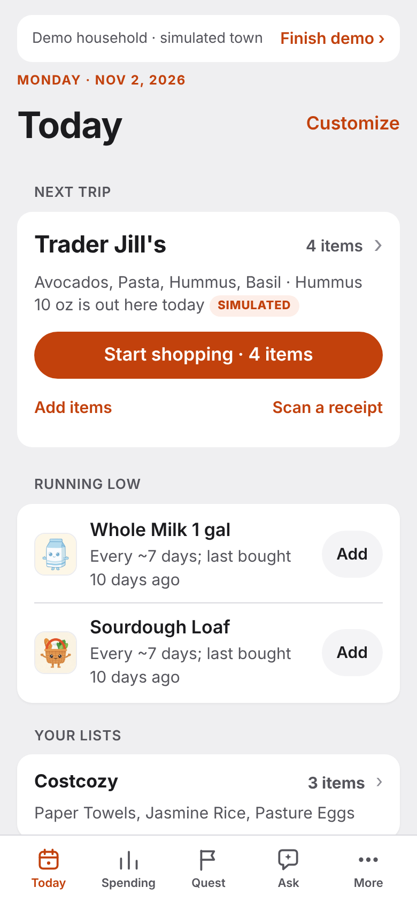
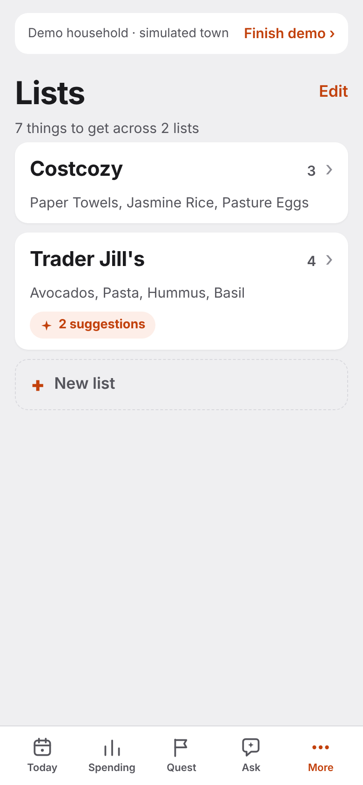

# What Arya is

Arya learns how you shop from your receipts and helps shoppers help each other.

Every week your list app starts blank. It doesn't know what you buy, what you returned, or where you buy it. Your receipts know all of that, and nobody reads them. So the list lives half in your head: you forget the milk, you buy the yogurt you still have, and the trip takes longer than it should. Same thing, every week.

## The loop

1. **Snap a receipt.** Muse Spark reads it, and Arya checks every line against the printed total in plain code. If the check fails or Spark is unsure, Muse Wonder reads it again. Doubtful lines wait in a review queue for you to check.
2. **Arya learns.** It learns what your household buys, how often, and at which store. Today shows what is running low and what to use soon, each with a reason ("about every 7 days, last bought 10 days ago"). Arya suggests; you decide what goes on the list.
3. **Shop.** Add items by typing, by voice or with a photo of a note. Tell Ask Arya "we finished the Greek yogurt" and it is on the list. Start shopping turns the list into an optional hunt through the store, and Muse Spark and SAM 3.1 find an item on the shelf for you. SAM pixelates the people it detects first.
4. **Together.** Groups share lists and receipts, and your own receipts go with you if you leave. Shoppers' store maps merge, so each trip helps the next.

*Today and Lists in the demo household (a simulated neighborhood, labelled as such).*

## What is real, and what is not

| Real | Simulated | Not connected |
|---|---|---|
| The live app. Receipts read by Meta models and checked in code. The Lists API and the Muse connector. | The demo household and Demo Town: invented stores and receipts, labelled as simulated. The demo reads a receipt live but keeps nothing. | Store accounts, retailer data, ordering and payment. |

Built and tested with US receipts, dollars and stores first. Size and other limits: [Known limits](../../README.md#known-limits).

## Which Meta model does what

- **Muse Spark** reads receipts first, judges which staples to suggest, and answers Ask Arya.
- **Muse Wonder** re-reads a receipt the checks flag.
- **SAM 3.1** finds shelves and items in a store scan and pixelates people.
- **Muse Voice Transcribe** takes dictation.
- **Muse Spark Open** is a second opinion on staples, from item names alone.
- **Muse Image** drew the Quest characters.

## Where next

[Try the demo](https://arya.teamnightshift.org) (no sign-up). Judging this? Start with [For judges](../../JUDGES.md). Everything else: [the full README](../../README.md).
